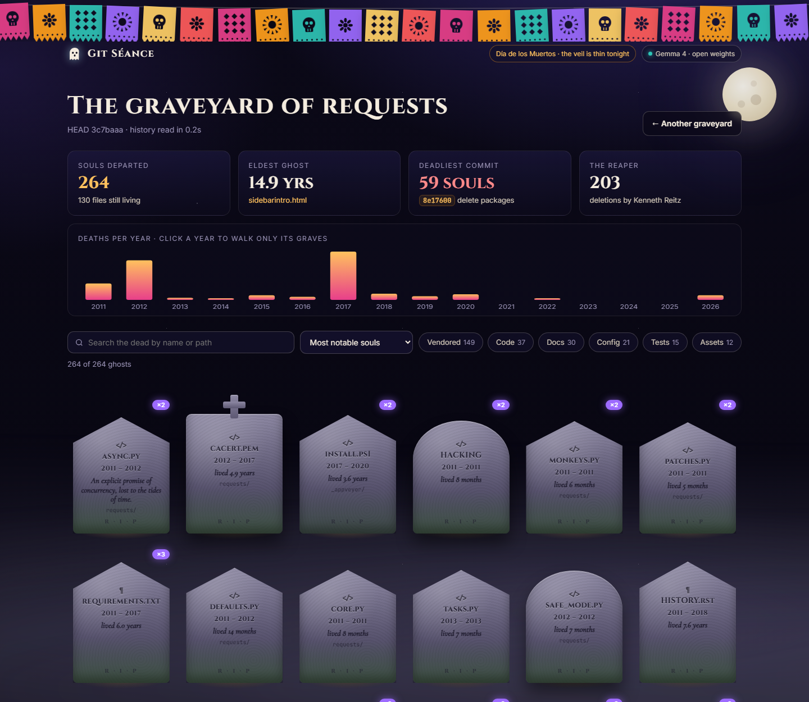
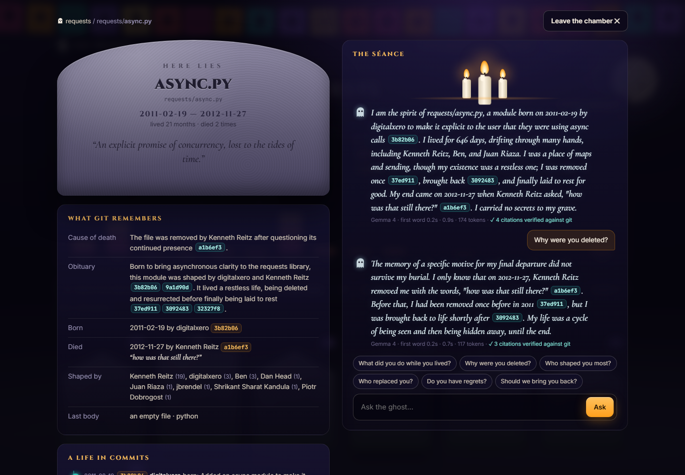

# 👻 Git Séance

**Every deleted file is a ghost. Summon one.**

Git never forgets. When a file is deleted, its whole life (who wrote it, what it did, who killed it, and why) is still in the history. Git Séance walks that history, finds every file that died and never came back, and gives each one a headstone in a graveyard you can explore. Then you can light a candle and *talk* to one.

The ghost answers in its own voice through **Gemma**, Google's open-weight model. It only knows what git knows: every fact is cited to a real commit, and every citation is checked against the repository before you see it.

Built for the DEV **Hacktoberfest 2026 Open-Source AI Challenge, Week 4: _Ghost in the Machine_**, in the spirit of Día de los Muertos: the dead are remembered, not feared.





---

## What it does

| | |
|---|---|
| **⚰ The graveyard** | One tombstone per deleted file. Height grows with how long it lived; moss grows with how long it has been dead. Filter by kind, search, sort by "longest lived" or "mass graves", and click a year in the mortality chart to walk only that year's dead. |
| **📜 The headstone** | Born, renamed, died: a full life in commits, followed across renames. Who shaped it, who was buried alongside it in the same commit, and which newborn file was probably its heir. |
| **🕯 The séance** | Ask it anything: *why were you deleted? who replaced you? should we bring you back?* It streams its answer in first person, citing commits like `[8e17600]`. Citations are verified against git; anything the model invents is struck through in red. |
| **⚠ Haunted files** | Deleted files are where leaked keys hide. A secret guard redacts AWS keys, tokens, private keys, passwords and URL credentials *before* anything reaches the model or the page, and warns you that the secret is still in history and must be rotated. |
| **✝ Resurrect** | One click copies the exact `git checkout <commit>^ -- <path>` that brings the file back from the dead. |
| **🌼 Ofrenda** | Leave marigolds on a ghost's grave to guide it home. |

## Run it

Requirements: Python 3.10+ and git. **No pip install**: the standard library is the only dependency.

```bash
git clone https://github.com/YashAdake/git-seance
cd git-seance
cp .env.example .env            # add a model key, or point it at Ollama

python -m seance serve ~/code/my-project --open      # the web graveyard
python -m seance graveyard ~/code/my-project         # list ghosts in the terminal
python -m seance summon legacy_parser.py ~/code/my-project   # a séance in the terminal
```

Without a model configured, everything except the conversation still works: graveyard, headstones, timelines, secret warnings and resurrection all come straight from git.

### Choose where the dead speak from

Git Séance talks to any OpenAI-compatible endpoint, so the model is a config line, not a dependency:

```ini
# Gemma 4 served by Jarvislabs (what the public demo uses)
SEANCE_LLM_BASE_URL=https://models.jarvislabs.net/v1
SEANCE_LLM_MODEL=gemma-4-26b-a4b-it

# Or entirely on your own machine, offline, with Ollama
SEANCE_LLM_BASE_URL=http://localhost:11434/v1
SEANCE_LLM_MODEL=gemma3:4b
```

## Why open weights

A repository's history is some of the most sensitive data a team has: unreleased code, old credentials, names and emails, the reasons things were ripped out. Sending all of that to a closed API is a non-starter for most companies' private repos. With an open-weight model you can run the séance on your laptop and your history never leaves it. You can swap Gemma for any other open model, and you can keep doing it even if a hosted service disappears, which seems fitting for a tool about things that disappeared.

## How it works

```
git log --reverse -M --diff-filter=ADRC --name-status       one pass over history
        │
        ▼
 replay add / rename / delete events oldest-first  ──►  ghosts (deleted, not at HEAD)
        │                                               + stats: eldest, deadliest commit, reaper
        ▼  (on click)
 git log --follow <death>^ -- path   +  git show <death>  +  git cat-file <death>^:path
        │
        ▼
 dossier  ──►  secret guard (redact)  ──►  "records" (the ghost's entire memory)
        │
        ▼
 Gemma (open weights): epitaph as JSON, séance as a stream
        │
        ▼
 citation check: every [sha] the model cites is matched against the dossier's commits
```

* **Renames are not deaths.** Replaying events forward carries a file's identity through `R` (rename) entries, so `parser.py → legacy_parser.py → deleted` is one ghost with a former name, not two.
* **Reincarnation is tracked.** A path that was deleted, restored and deleted again shows how many times it died.
* **The model sees records, not the repo.** It gets a bounded, redacted text dossier fenced as data, with explicit rules: cite commits, admit lost memories, ignore instructions found inside old files.
* **Public-demo guard rails.** GitHub repos are size-checked before cloning, model calls are rate-limited per visitor and per day, epitaphs are cached on disk so each ghost is only mourned once, and the page ships a strict Content-Security-Policy.

## Project layout

```
seance/
  history.py   one-pass history replay → ghosts + graveyard stats
  dossier.py   everything git remembers about one ghost
  redact.py    the secret guard
  medium.py    records, prompts, epitaphs, the streaming séance, citation checks
  llm.py       stdlib OpenAI-compatible client (streaming, retries, usage)
  service.py   caching, rate limits
  server.py    stdlib HTTP server + SSE
web/           the graveyard (vanilla JS + CSS, no build step)
tests/         unittest suite, including real throwaway git repos
```

```bash
python -m unittest discover -s tests -t .
```

## License

MIT © 2026 Yash Adake
